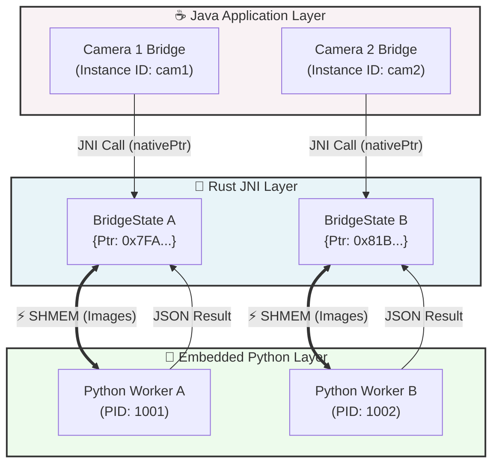
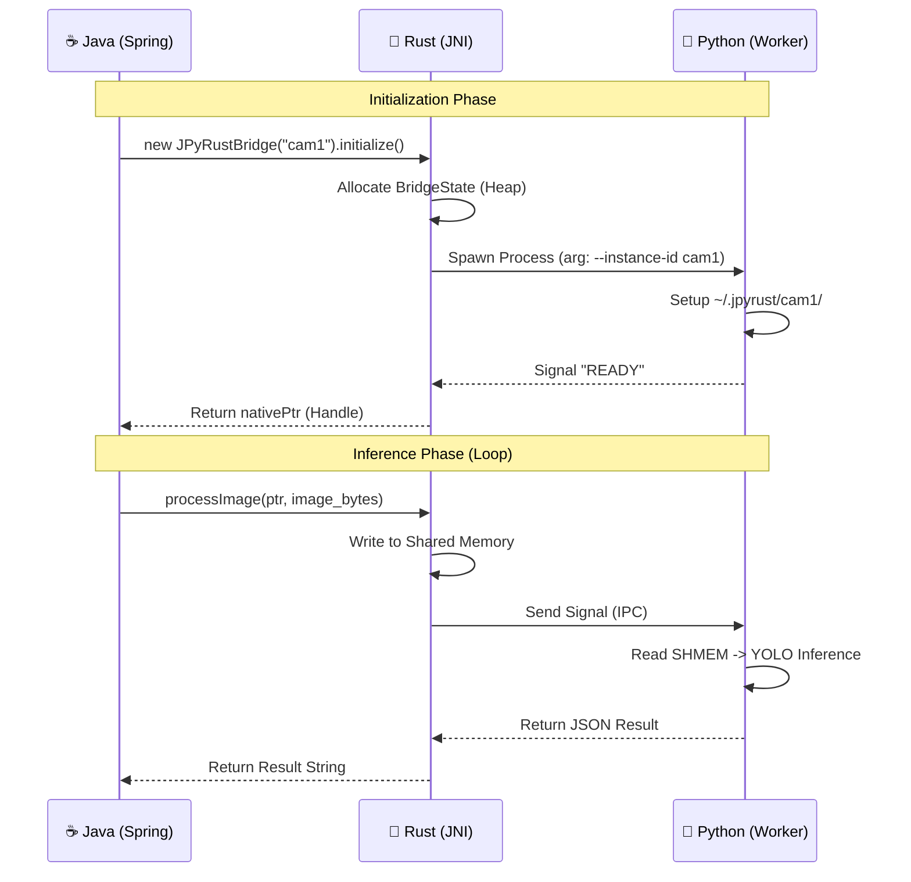

# 🚀 JPyRust: High-Performance Universal AI Bridge

> **"A persistent Python worker for Java, reached over JNI + shared memory instead of a subprocess per call."**

[](https://github.com/farmer0010/JPyRust/actions)
[](https://jitpack.io/#farmer0010/JPyRust)
[](LICENSE)


<p align="center">
  <a href="https://openjdk.org/">
    
  </a>
  <a href="https://www.rust-lang.org/">
    
  </a>
  <a href="https://www.python.org/">
    
  </a>
</p>

<div align="center">
  <a href="README_KR.md">🇰🇷 한국어 버전 (Korean Version)</a> · <a href="docs/GUIDE.md">📚 User Guide</a>
</div>

---

## 💡 Introduction

**JPyRust** is a hybrid architecture designed to bridge the gap between **Java's robustness** and **Python's AI ecosystem**. It enables Spring Boot applications to execute heavy AI models (YOLO, PyTorch, TensorFlow) with **near-native performance**.

Unlike slow `ProcessBuilder` or high-latency HTTP APIs, JPyRust leverages **Rust JNI** and **Shared Memory (SHMEM)** to achieve sub-millisecond communication.

### 🌟 Why JPyRust?
* 🚀 **Zero-Latency**: Uses System RAM (Shared Memory) instead of HTTP/Sockets.
* 🔄 **True Parallelism**: v1.3.0 supports **Multi-Instance** architecture (1 Java App connects to N Python Processes).
* 🛠️ **Zero-Config**: Auto-provisions its Python environment on first run — a fully embedded distribution on Windows, a `uv`-managed venv on macOS/Linux. No manual `pip install`. On macOS/Linux the interpreter itself is fetched over the network on first run too (`uv` downloads a portable Python 3.11, ~25MB) — it's no longer assumed to already be on your machine.
* 🛡️ **Crash-Proof**: Rust monitors Python health and auto-restarts workers if they crash.

---

## 🏗️ Architecture (v1.3.0)

With the **v1.3.0 update**, JPyRust has moved from a generic Singleton pattern to a **Multi-Instance Object-Oriented Architecture**. This allows a single Java application to control multiple independent AI workers (e.g., Multi-Channel CCTV processing).

### 🧩 System Component Diagram



### ⚡ Execution Sequence



---

## ⚡ Performance Benchmark

A real, runnable benchmark ships with the repo: [`LatencyBenchmark.java`](java-api/src/test/java/com/jpyrust/LatencyBenchmark.java). It runs real YOLOv8n inference on an actual image (`sample.png`), 10 iterations after warmup, comparing:
- **Legacy Subprocess** — spawns a brand-new Python interpreter (full torch/ultralytics import + model load) for every single call.
- **JPyRust (JNI + SHMEM)** — reuses one persistent Python daemon with the model already loaded; only the image crosses via shared memory.

| Architecture | Communication | Latency (Avg, measured) |
| :--- | :--- | :---: |
| Legacy Subprocess (cold spawn per call) | Stdin/Stdout | ~2,330 ms |
| JPyRust (JNI + SHMEM, persistent daemon) | Shared Memory | ~6 ms |

> *Measured on: Apple Silicon (arm64), macOS, PyTorch with MPS (Metal) acceleration, Python 3.12. ~390x faster, consistent across repeated runs.*

Nearly all of the "legacy" cost is one-time interpreter/library/model-load overhead (torch + ultralytics import, `YOLO(...)` construction) paid on *every single call* — the actual inference itself is only a few milliseconds. The daemon architecture pays that cost once at startup instead of per-request, which is the entire point of keeping a persistent worker around. Run `LatencyBenchmark` yourself to reproduce this against your own hardware — numbers will vary with CPU/GPU and image size, but the shape of the result (overhead dominates, not compute) should hold generally.

---

## 🚀 Quick Start

### 1. Installation (Gradle)
Add the JitPack repository and dependency to your `build.gradle.kts`:

```kotlin
repositories {
    maven { url = uri("[https://jitpack.io](https://jitpack.io)") }
}

dependencies {
    // Latest stable version
    implementation("com.github.farmer0010:JPyRust:v1.3.1")
}
```

### 2. Usage (Java)

**Important:** As of v1.3.0, static methods are removed. You must instantiate `JPyRustBridge`.

```java
import com.jpyrust.JPyRustBridge;

public class VisionService {
    
    public void startDetection() {
        // 1. Create independent instances for each camera
        JPyRustBridge cam1 = new JPyRustBridge("cam1");
        JPyRustBridge cam2 = new JPyRustBridge("cam2");

        // 2. Initialize with defaults (Spawns workers in ~/.jpyrust/camX)
        cam1.initialize();

        // 2-1. (v1.3.1+) Initialize with a custom model & confidence threshold
        cam2.initialize("/path/to/workdir", "custom_model.pt", 0.25f);

        // 3. Process Images (Thread-Safe)
        // arg: (imageData, length, width, height, channels)
        byte[] result1 = cam1.processImage(imgData1, len1, 640, 480, 3);
        byte[] result2 = cam2.processImage(imgData2, len2, 640, 480, 3);
        
        System.out.println("Cam1 Result: " + new String(result1));
    }
}
```

### 3. Usage (Java) — Audio / Whisper

**New:** JPyRust can also transcribe audio via [OpenAI Whisper](https://github.com/openai/whisper), reusing the same persistent-daemon architecture as YOLO.

```java
import com.jpyrust.JPyRustBridge;

public class SpeechService {

    public void startTranscription() {
        JPyRustBridge stt = new JPyRustBridge("stt");

        // Initialize with a Whisper model name (e.g. "tiny", "base", "small") or a local .pt checkpoint path.
        // The trailing whisperModelPath argument is the only difference from the image-only overload.
        stt.initialize("/path/to/workdir", "yolov8n.pt", 0.5f, "session-key", "tiny");

        // arg: (audioData WAV bytes, length, sampleRate)
        byte[] result = stt.processAudio(audioBuffer, audioLength, 16000);

        // {"recognized_text": "...", "confidence": 0.87}
        System.out.println("Transcription: " + new String(result));
    }
}
```

> Audio input is expected as a WAV container (16kHz, mono, 16-bit PCM). `confidence` is an approximation derived from Whisper's per-segment `avg_logprob`, not a calibrated probability.


---

## 🛠️ Configuration & Troubleshooting

<details>
<summary><strong>🔧 1. UnsatisfiedLinkError / DLL Not Found</strong></summary>

* **Cause:** Java cannot find the native library.
* **Fix:** The library is bundled in the JAR and extracted to a temp file automatically — `jpyrust.dll` (Windows), `jpyrust.dylib` (macOS), or `jpyrust.so` (Linux). If it still fails, check that your platform's file is present under `src/main/resources/natives/` in the JAR you're using.
</details>

<details>
<summary><strong>🛡️ 2. WinError 5 (Access Denied)</strong></summary>

* **Cause:** Windows Security permissions on Shared Memory.
* **Fix:** JPyRust v1.2+ uses explicit `SECURITY_ATTRIBUTES` with SDDL `D:P(A;;GA;;;OW)(A;;GA;;;SY)`, granting access only to the owning user and SYSTEM so the Python child process (same user) can open the mapping. No manual action required.
</details>

<details>
<summary><strong>🐍 3. Python Dependency Issues</strong></summary>

* **Windows:** JPyRust includes a **portable embedded Python**. It bootstraps itself in `~/.jpyrust/<instanceId>/python_dist`.
* **macOS / Linux:** there is no portable embedded Python for these platforms, so JPyRust requires [`uv`](https://docs.astral.sh/uv/getting-started/installation/) on your `PATH` and runs `uv venv --python 3.11 --seed` to provision a private virtualenv at `~/.jpyrust/<instanceId>/venv`, then installs `requirements.txt` into it. `uv` fetches a portable Python 3.11 on first run if one isn't already managed by `uv` — no manual interpreter install needed. This runs once per instance directory (tracked by a `.installed` marker) — delete that directory to force a clean reinstall. Install `uv` via `curl -LsSf https://astral.sh/uv/install.sh | sh` or a package manager, e.g. `brew install uv` on macOS.
* If libraries are missing, check `requirements.txt` in the resource folder.
* **Docker:** the published base image ships no Python and no `uv`, so AI inference features do not currently work inside the container — see the Docker note below.
</details>

<details>
<summary><strong>⏱️ 4. Errors & Timeouts</strong></summary>

Native failures surface as Java exceptions instead of crashing the JVM or returning `null`.

| Situation | What you get |
| --- | --- |
| `processImage` / `processAudio` / `sendTask` before `initialize()` or after `close()` | `IllegalStateException` |
| Python task fails (decode error, unknown task, missing model, ...) | `RuntimeException` with the worker's `ERROR ...` message |
| Result larger than the 1 MB shared-memory output buffer (YOLO, EDGE_DETECT) | `RuntimeException` (`Output too large: ...`) |
| Heap `ByteBuffer` passed, or `length` larger than the buffer | `RuntimeException` (`Input must be a direct ByteBuffer` / `Invalid input length ...`) |
| Python daemon does not start during `initialize()` | `RuntimeException` (`Failed to initialize JPyRustBridge`, cause `Daemon start failed: ...`) |

`processEdgeDetection` still returns `null` on failure, and `processNlp` / `processRegression` still return an `{"error": ...}` JSON string — these wrappers catch the exception themselves.

| Timeout | Value | On expiry |
| --- | --- | --- |
| Daemon startup (waiting for `READY`, includes model loading) | 600 s | Process is killed, call throws |
| Single task (waiting for `DONE` / `ERROR`) | 300 s | Process is killed, call throws; the next call spawns a fresh daemon (startup timeout applies again) |

* Timeouts are fixed constants (`READY_TIMEOUT`, `TASK_TIMEOUT` in `rust-bridge/src/lib.rs`) and are not configurable yet.
* Each instance has one daemon and processes requests one at a time, so a task that hangs blocks other requests on the same instance for up to 300 s. Use separate instances (`new JPyRustBridge("id")`) for independent workloads.
* A crashed daemon is respawned automatically on the next call; that call pays the startup cost (model reload).
</details>

---

## 📜 Version History

* **Unreleased**
    * **Behavior Change:** `processImage`, `processAudio` and the new `sendTask` throw `RuntimeException` on failure instead of returning `null`; calling them before `initialize()` or after `close()` throws `IllegalStateException`. `initialize()` now throws if the Python daemon fails to start (previously it only logged and left the bridge half-initialized). See *Errors & Timeouts* above.
    * **Fix:** Rust JNI entry points are wrapped in `catch_unwind` — a native panic or JNI error becomes a Java exception instead of aborting the JVM. `executeTask` and `close()` are synchronized, so closing during an in-flight call can no longer free native state underneath it.
    * **Fix:** Waiting on the Python daemon now actually times out (600 s startup, 300 s per task); a hung or dead daemon is killed and respawned on the next call. The previous 600 s startup timeout never fired because the read it guarded was blocking.
    * **Fix:** Results larger than the 1 MB shared-memory output buffer raise an error instead of silently returning an empty array.
    * **Feature:** `sendTask(taskType, metadata)` calls any task registered in `ai_worker.py` and returns its output as a UTF-8 string.
    * **Security:** Windows shared-memory mappings are restricted to the owning user and SYSTEM (`D:P(A;;GA;;;OW)(A;;GA;;;SY)`) instead of Everyone.
    * **Fix:** macOS/Linux venv provisioning switched from searching `PATH` for a system `python3.12`/`python3.11`/`python3.13`/`python3` to `uv venv --python 3.11 --seed`, which pins an exact interpreter version instead of depending on whatever happens to be installed. This fixes local environments where the only system `python3` was 3.13+ and `requirements.txt`'s pinned `numpy`/`torch`/etc. had no matching wheels.
    * **Feature:** Audio transcription via OpenAI Whisper — new `processAudio(data, length, sampleRate)` on the Java side and a `WHISPER` task handler in `ai_worker.py`, reusing the existing generic `executeTask` JNI call (no new native entry point). Routes through the file-based IPC fallback, which already supports variable-length payloads.
    * **Feature:** `initialize(workDir, modelPath, confidence, memoryKey, whisperModelPath)` overload to configure the Whisper model (name or local checkpoint path) alongside the existing YOLO model/confidence.
    * **Fix:** `modelPath`/`confidence` passed to `initialize(...)` were previously read in Rust but never actually forwarded to the Python daemon process — Python silently kept using its own argparse defaults regardless of what was passed. The daemon spawn now passes `--model`/`--conf`/`--whisper-model` through for real.
    * **Note:** `openai-whisper` ships no PyPI wheel (sdist only), so it's excluded from the Windows embedded offline distribution (`downloadWheels`/`stagePython`) — Windows users get YOLO/image features fully offline, Whisper requires network on first install. macOS/Linux (venv bootstrap) installs it via `--no-build-isolation` with a pinned older `setuptools` (its legacy `setup.py` needs `pkg_resources`).
    * **Feature:** macOS/Linux now provision a Python venv from the system `python3` for a fully native setup path.
    * **Perf:** Tuned shared-memory naming for cross-platform consistency (Rust ↔ Python) and to stay within macOS's `shm_open` limits.
    * **Feature:** Added MPS (Metal) as a device option on Apple Silicon, alongside CUDA/CPU.
    * **Chore:** Refined internal script paths and the legacy-subprocess benchmark protocol for consistency across platforms.

* **v1.3.1**
    * **Linux/Docker Support:** `setupEmbeddedPython` detects the OS and uses the system `python3` on Linux instead of the Windows-only embedded distribution.
    * **Custom Parameters:** New `initialize(workDir, modelPath, confidence)` overload for custom AI model configuration.
    * **Backward Compatible:** Existing `initialize(workDir)` still works with defaults (`yolov8n.pt`, `0.5f`).

* **v1.3.0**
    * **Major Refactor:** Switched to Multi-Instance Architecture.
    * **Breaking Change:** Removed static methods; added Constructor-based instantiation.
    * **Feature:** Isolated working directories per instance (`~/.jpyrust/cam1`).

* **v1.2.0**
    * **Performance:** Restored Shared Memory (SHMEM) on Windows via Win32 API.
    * **Security:** Fixed `WinError 5` using custom Security Descriptors.

* **v1.1.0**
    * Initial Windows Support & File-based IPC fallback.

---

## 📄 License

This project is licensed under the **MIT License** - see the [LICENSE](LICENSE) file for details.

<div align="center">
  <sub>Built with 🦀 Rust & ☕ Java by Farmer0010 (JPyRust Team).</sub>
</div>
