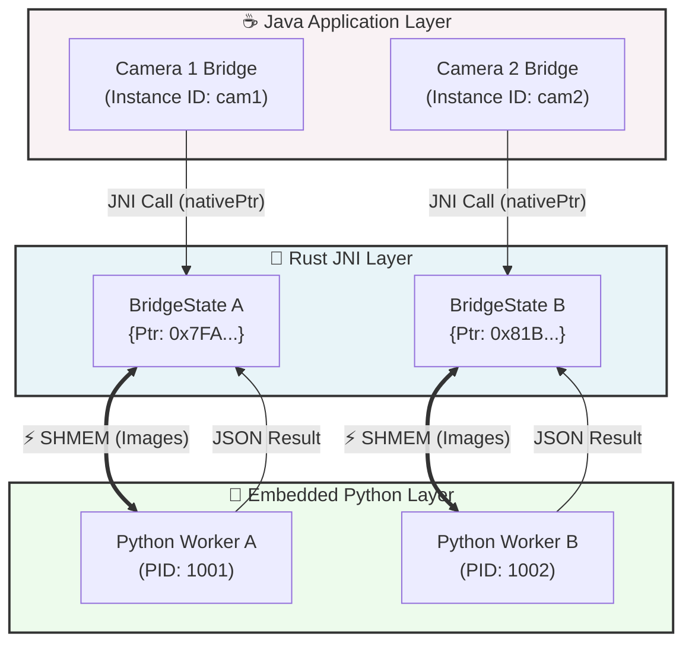
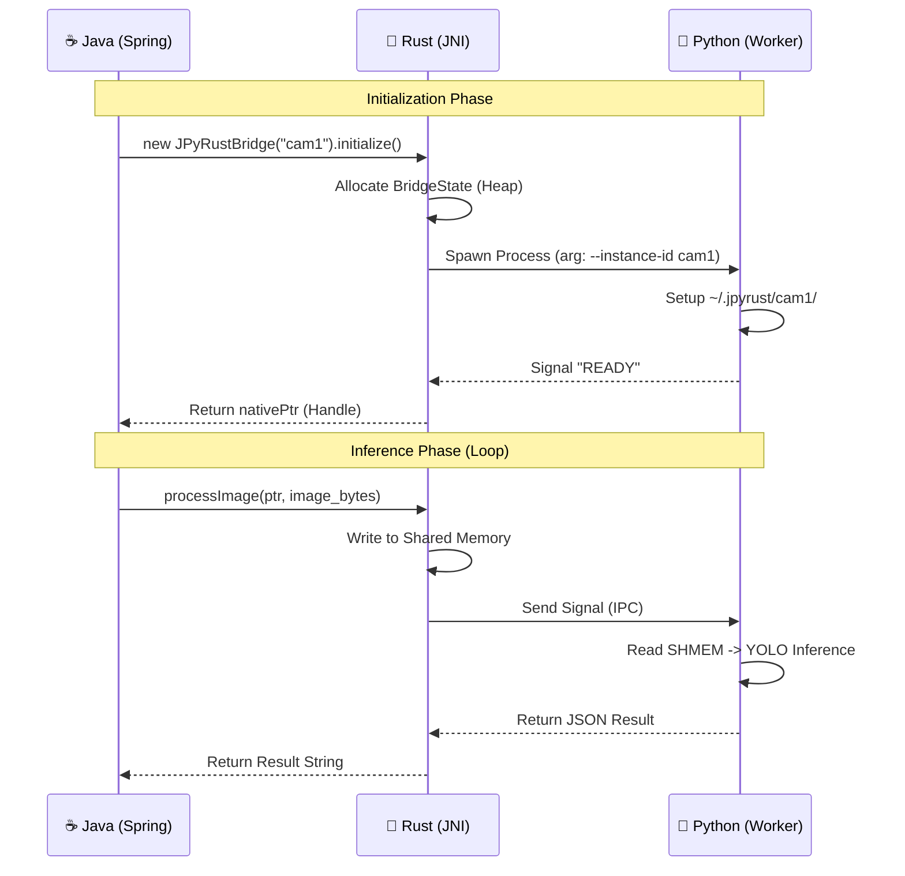

# 🚀 JPyRust: High-Performance Universal AI Bridge

> **"A persistent Python worker for Java, reached over JNI + shared memory instead of a subprocess per call."**

[](https://github.com/farmer0010/JPyRust/actions)
[](https://jitpack.io/#farmer0010/JPyRust)
[](LICENSE)


<p align="center">
  <a href="https://openjdk.org/">
    
  </a>
  <a href="https://www.rust-lang.org/">
    
  </a>
  <a href="https://www.python.org/">
    
  </a>
</p>

<div align="center">
  <a href="docs/README_KR.md">🇰🇷 한국어 버전 (Korean Version)</a> · <a href="docs/GUIDE.md">📚 User Guide</a> · <a href="docs/ARCHITECTURE.md">🏗️ Architecture</a> · <a href="docs/CONTRIBUTING.md">🤝 Contributing</a>
</div>

---

## 💡 Introduction

**JPyRust** is a hybrid architecture designed to bridge the gap between **Java's robustness** and **Python's AI ecosystem**. It enables Spring Boot applications to execute heavy AI models (YOLO, PyTorch, TensorFlow) with **near-native performance**.

Unlike slow `ProcessBuilder` or high-latency HTTP APIs, JPyRust leverages **Rust JNI** and **Shared Memory (SHMEM)** to achieve sub-millisecond communication.

### 🌟 Why JPyRust?
* 🚀 **Zero-Latency**: Uses System RAM (Shared Memory) instead of HTTP/Sockets.
* 🔄 **True Parallelism**: v1.3.0 supports **Multi-Instance** architecture (1 Java App connects to N Python Processes).
* 🛠️ **Zero-Config**: Auto-provisions its Python environment on first run — python.org's embeddable Python 3.11.9 on Windows (~11MB), a checksum-verified portable CPython 3.11.18 from [python-build-standalone](https://github.com/astral-sh/python-build-standalone) (~26MB) on macOS/Linux. Nothing needs to be installed first, not even Python; downloads are cached in `~/.jpyrust/cache` and shared by every instance.
* 🛡️ **Crash-Proof**: Rust monitors Python health and auto-restarts workers if they crash.

---

## 🏗️ Architecture (v1.3.0)

With the **v1.3.0 update**, JPyRust has moved from a generic Singleton pattern to a **Multi-Instance Object-Oriented Architecture**. This allows a single Java application to control multiple independent AI workers (e.g., Multi-Channel CCTV processing).

### 🧩 System Component Diagram



### ⚡ Execution Sequence



---

## ⚡ Performance Benchmark

A real, runnable benchmark ships with the repo: [`LatencyBenchmark.java`](java-api/src/test/java/com/jpyrust/LatencyBenchmark.java). It runs real YOLOv8n inference on an actual image (`sample.png`), 10 iterations after warmup, comparing:
- **Legacy Subprocess** — spawns a brand-new Python interpreter (full torch/ultralytics import + model load) for every single call.
- **JPyRust (JNI + SHMEM)** — reuses one persistent Python daemon with the model already loaded; only the image crosses via shared memory.

| Architecture | Communication | Latency (Avg, measured) |
| :--- | :--- | :---: |
| Legacy Subprocess (cold spawn per call) | Stdin/Stdout | ~2,330 ms |
| JPyRust (JNI + SHMEM, persistent daemon) | Shared Memory | ~6 ms |

> *Measured on: Apple Silicon (arm64), macOS, PyTorch with MPS (Metal) acceleration, Python 3.12. ~390x faster, consistent across repeated runs.*

Nearly all of the "legacy" cost is one-time interpreter/library/model-load overhead (torch + ultralytics import, `YOLO(...)` construction) paid on *every single call* — the actual inference itself is only a few milliseconds. The daemon architecture pays that cost once at startup instead of per-request, which is the entire point of keeping a persistent worker around. Run `LatencyBenchmark` yourself to reproduce this against your own hardware — numbers will vary with CPU/GPU and image size, but the shape of the result (overhead dominates, not compute) should hold generally.

---

## 🚀 Quick Start

### 1. Installation (Gradle)
Add the JitPack repository and dependency to your `build.gradle.kts`:

```kotlin
repositories {
    maven { url = uri("[https://jitpack.io](https://jitpack.io)") }
}

dependencies {
    // Latest stable version
    implementation("com.github.farmer0010:JPyRust:v1.3.1")
}
```

### 2. Usage (Java)

**Important:** As of v1.3.0, static methods are removed. You must instantiate `JPyRustBridge`.

The built-in AI tasks are opt-in **extras**. The default install is only `numpy`; enable an extra with `extras(...)` before `initialize()` and its Python dependencies are installed with it.

| Extra | Tasks / Java methods | Installs | License note |
| --- | --- | --- | --- |
| `vision` | `YOLO` (`processImage`), `EDGE_DETECT` (`processEdgeDetection`) | `ultralytics`, `torch`, `torchvision`, `opencv-python-headless` | `ultralytics` is **AGPL-3.0** |
| `audio` | `WHISPER` (`processAudio`) | `openai-whisper`, `torch` | |
| `ml` | `NLP_TEXTBLOB` (`processNlp`), `REGRESSION` (`processRegression`) | `pandas`, `scikit-learn`, `textblob` | |

Calling a task without its extra fails with `Task YOLO requires extras("vision")`.

```java
import com.jpyrust.JPyRustBridge;

public class VisionService {
    
    public void startDetection() {
        // 1. Create independent instances for each camera
        JPyRustBridge cam1 = new JPyRustBridge("cam1").extras("vision");
        JPyRustBridge cam2 = new JPyRustBridge("cam2").extras("vision");

        // 2. Initialize with defaults (Spawns workers in ~/.jpyrust/camX)
        cam1.initialize();

        // 2-1. (v1.3.1+) Initialize with a custom model & confidence threshold
        cam2.initialize("/path/to/workdir", "custom_model.pt", 0.25f);

        // 3. Process Images (Thread-Safe)
        // arg: (imageData, length, width, height, channels)
        byte[] result1 = cam1.processImage(imgData1, len1, 640, 480, 3);
        byte[] result2 = cam2.processImage(imgData2, len2, 640, 480, 3);
        
        System.out.println("Cam1 Result: " + new String(result1));
    }
}
```

### 3. Usage (Java) — Audio / Whisper

**New:** JPyRust can also transcribe audio via [OpenAI Whisper](https://github.com/openai/whisper), reusing the same persistent-daemon architecture as YOLO.

```java
import com.jpyrust.JPyRustBridge;

public class SpeechService {

    public void startTranscription() {
        JPyRustBridge stt = new JPyRustBridge("stt").extras("audio");

        // Initialize with a Whisper model name (e.g. "tiny", "base", "small") or a local .pt checkpoint path.
        // The trailing whisperModelPath argument is the only difference from the image-only overload.
        stt.initialize("/path/to/workdir", "yolov8n.pt", 0.5f, "session-key", "tiny");

        // arg: (audioData WAV bytes, length, sampleRate)
        byte[] result = stt.processAudio(audioBuffer, audioLength, 16000);

        // {"recognized_text": "...", "confidence": 0.87}
        System.out.println("Transcription: " + new String(result));
    }
}
```

> Audio input is expected as a WAV container (16kHz, mono, 16-bit PCM). `confidence` is an approximation derived from Whisper's per-segment `avg_logprob`, not a calibrated probability.

### 4. Usage (Java) — Your Own Python Code

Register any Python function as a task and call it from Java. You choose the Python dependencies, and nothing beyond `numpy` is installed unless you ask for it.

```python
# tasks/text_tasks.py
from jpyrust import task

@task("WORD_COUNT")
def word_count(data: bytes, args: str):
    return {"words": len(data.decode("utf-8").split()), "args": args}
```

```java
JPyRustBridge bridge = new JPyRustBridge("text")
        .requirements(Path.of("python/requirements.txt"))
        .moduleDir(Path.of("python/tasks"));
bridge.initialize();

String json = bridge.call("WORD_COUNT", "hello jpyrust");        // {"words": 2, "args": ""}
byte[] raw = bridge.call("WORD_COUNT", bytes, "any args here");  // raw bytes in, raw bytes out
```

* A task receives the input bytes and the `args` string. Returning `bytes` sends them as-is, `str` is UTF-8 encoded, anything else is sent as JSON. An exception becomes a `RuntimeException` in Java.
* Every `.py` file in each `moduleDir` is imported at daemon start. Task names are case-insensitive, and a registered task replaces a built-in one with the same name. A module that fails to import is reported on stderr and skipped.
* `requirements(...)` replaces the bundled core `requirements.txt`; requirements of enabled extras are appended to it. The install is keyed by the file's SHA-256, so changing it re-runs `pip install` on the next `initialize()`.
* Custom tasks go through the file-based IPC path, so their output has no 1 MB limit.


---

## 🛠️ Configuration & Troubleshooting

<details>
<summary><strong>🔧 1. UnsatisfiedLinkError / DLL Not Found</strong></summary>

* **Cause:** Java cannot find the native library.
* **Fix:** The library is bundled in the JAR and extracted to a temp file automatically — `jpyrust.dll` (Windows), `jpyrust.dylib` (macOS), or `jpyrust.so` (Linux). Natives live under `natives/<os>-<arch>/` in the JAR (`windows-x86_64`, `linux-x86_64`, `linux-aarch64`, `darwin-aarch64`, `darwin-x86_64`). The JitPack build only contains the three committed to the repo (`windows-x86_64`, `linux-x86_64`, `darwin-aarch64`); the JAR attached to each GitHub Release contains all five. If loading fails, the error lists the exact path that was looked up.
</details>

<details>
<summary><strong>🛡️ 2. WinError 5 (Access Denied)</strong></summary>

* **Cause:** Windows Security permissions on Shared Memory.
* **Fix:** JPyRust v1.2+ uses explicit `SECURITY_ATTRIBUTES` with SDDL `D:P(A;;GA;;;OW)(A;;GA;;;SY)`, granting access only to the owning user and SYSTEM so the Python child process (same user) can open the mapping. No manual action required.
</details>

<details>
<summary><strong>🐍 3. Python Dependency Issues</strong></summary>

* **Windows:** on the first `initialize()`, JPyRust downloads python.org's embeddable Python 3.11.9 and a pinned `pip` wheel, verifies both against SHA-256 hashes built into the library, unpacks Python into `~/.jpyrust/<instanceId>/python_dist`, and installs `requirements.txt` plus the enabled extras from PyPI. Nothing extra needs to be installed, but the first run needs network access to python.org and PyPI (honoring `https.proxyHost` for the downloads and `HTTPS_PROXY` for pip). It runs once per instance directory (tracked by `python_dist/.installed`); a failed download, checksum mismatch or pip error makes `initialize()` throw.
* **macOS / Linux:** on the first `initialize()`, JPyRust downloads a portable CPython 3.11.18 build from python-build-standalone for your OS and architecture (x86_64/aarch64, glibc), verifies it against a SHA-256 hash built into the library, unpacks it into `~/.jpyrust/cache`, creates a private venv at `~/.jpyrust/<instanceId>/venv` and installs `requirements.txt` into it. Nothing needs to be installed beforehand (`tar` must be on `PATH`, as it is on every macOS and mainstream Linux). The venv is built once per instance directory (tracked by a `.installed` marker); delete that directory to force a clean reinstall. Alpine (musl) is not covered; use `python(...)` there.
* If a built-in task reports `requires extras(...)`, add that extra with `extras(...)`.
* **Offline / intranet:** `python(Path.of("/usr/bin/python3.11"))` builds the venv from an interpreter you already have (`python -m venv --system-site-packages`) instead of downloading one, on every OS. Packages already installed for that interpreter are reused, so pip only fetches what is missing. Point pip at an internal index with the standard `PIP_INDEX_URL` / `PIP_TRUSTED_HOST` environment variables or a `pip.conf`; the pip child process inherits them. The interpreter is chosen when the instance directory is first set up, so use a fresh directory to switch.
* **Docker:** glibc-based images (e.g. `eclipse-temurin`) work as-is: the first `initialize()` downloads Python into the container. Bake it in at build time by running your app's initialization once in a `RUN` step, or install Python in the image and pass it with `python(...)`. Docker's default 64 MB `/dev/shm` caps the shared-memory buffers; larger payloads go through files automatically, or raise the limit with `--shm-size`.
* **Logging:** JPyRust logs through `System.Logger` (logger name `com.jpyrust`), which goes to `java.util.logging` by default or to SLF4J/Log4j when their `System.Logger` bridge is on the classpath. pip output is logged at `DEBUG`.
</details>

<details>
<summary><strong>⏱️ 4. Errors & Timeouts</strong></summary>

Every failure is a `JPyRustException` (a `RuntimeException`), so the JVM never crashes and nothing returns `null`.

| Situation | What you get |
| --- | --- |
| Any call before `initialize()` or after `close()` | `IllegalStateException` |
| The Python task raises (bad input, unknown task, missing extra, ...) | `TaskFailedException` with the worker's `ERROR ...` message; the worker keeps running |
| The task runs longer than the task timeout | `WorkerTimeoutException`; the worker process is killed and respawned on the next call |
| The worker process dies (segfault, `os._exit`, OOM kill) | `WorkerCrashedException`; respawned on the next call |
| Heap `ByteBuffer` passed, or `length` larger than the buffer | `JPyRustException` (`Input must be a direct ByteBuffer` / `Invalid input length ...`) |
| The Python daemon does not start during `initialize()` | `JPyRustException` (`Failed to initialize JPyRustBridge`, cause `Daemon start failed: ...`) |

```java
JPyRustBridge bridge = new JPyRustBridge("svc")
        .timeouts(Duration.ofSeconds(120), Duration.ofSeconds(10))  // startup (incl. model load), per task
        .workers(4);                                                 // 4 Python processes, calls run in parallel
```

* Defaults are 600 s for startup and 300 s per task.
* `workers(n)` starts `n` Python processes sharing one environment. Calls from different threads run in parallel on separate processes, so CPU-bound Python code uses `n` cores instead of being serialized by one GIL. `callAsync(task, bytes, args)` returns a `CompletableFuture` backed by a pool of the same size.
* Data goes through reusable shared-memory buffers that grow as needed (up to 256 MB); larger payloads, or platforms where shared memory is unavailable, fall back to files automatically. There is no fixed output size limit.
* A respawned worker pays the startup cost again (model reload).
</details>

---

## 📜 Version History

See [CHANGELOG.md](docs/CHANGELOG.md).

---

## 📄 License

This project is licensed under the **MIT License** - see the [LICENSE](LICENSE) file for details.

<div align="center">
  <sub>Built with 🦀 Rust & ☕ Java by Farmer0010 (JPyRust Team).</sub>
</div>
