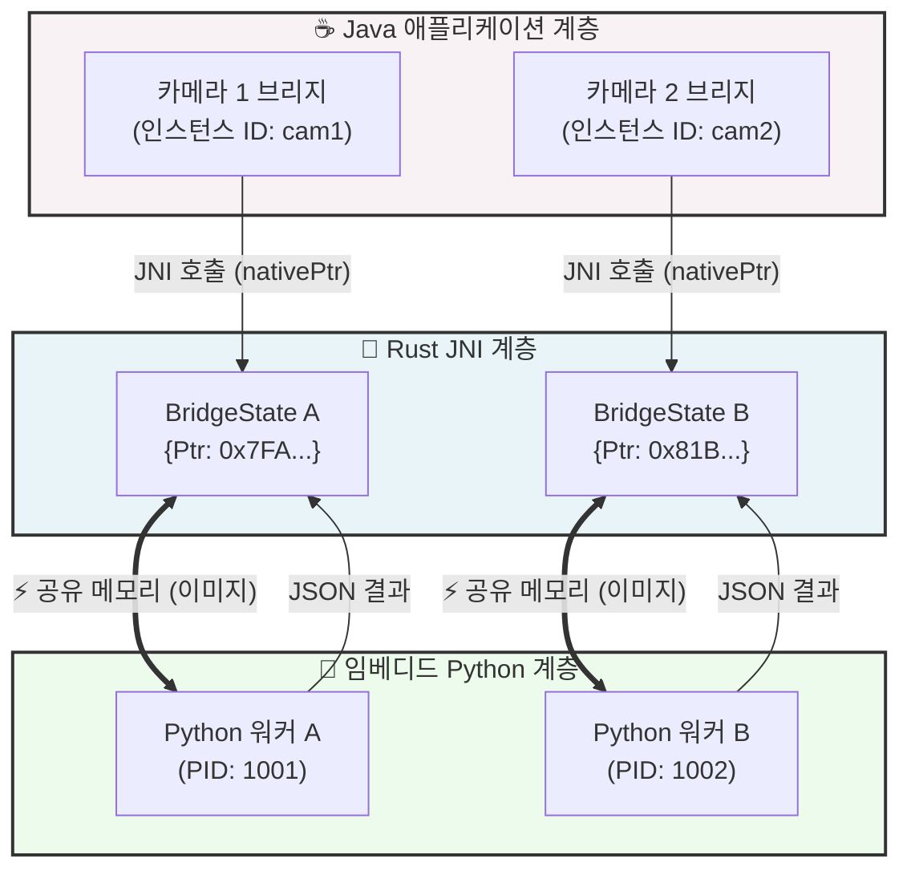
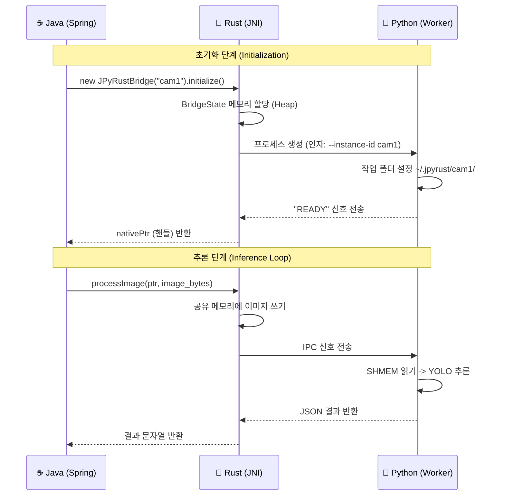

# 🚀 JPyRust: Python 서비스 없이 Java에서 CPython 호출

> **1.6MB JAR 하나로 끝납니다. Python은 JVM이 관리하는 워커 프로세스에서 돌고, 첫 실행 때 스스로 설치되며, 죽어도 JVM은 멈추지 않습니다.**

[](https://github.com/farmer0010/JPyRust/actions)
[](https://jitpack.io/#farmer0010/JPyRust)
[](../LICENSE)


<p align="center">
  <a href="https://openjdk.org/">
    
  </a>
  <a href="https://www.rust-lang.org/">
    
  </a>
  <a href="https://www.python.org/">
    
  </a>
</p>

<div align="center">
  <a href="../README.md">🇺🇸 English Version</a> · <a href="GUIDE_KR.md">📚 사용자 가이드</a> · <a href="ARCHITECTURE.md">🏗️ 아키텍처</a> · <a href="API.md">📖 API</a> · <a href="BENCHMARKS.md">⚡ 벤치마크</a> · <a href="COMPATIBILITY.md">🧭 호환성</a> · <a href="CONTRIBUTING.md">🤝 기여 가이드</a>
</div>

---

## 💡 프로젝트 소개

**JPyRust**는 Java 애플리케이션이 자기 Python 함수(scikit-learn 모델, PyTorch 파이프라인, pandas 코드)를 로컬 메서드처럼 부르게 해 줍니다. 따로 배포할 Python 서비스가 없습니다. 라이브러리가 고정 버전 CPython을 내려받고, `requirements.txt`로 venv를 만들고, `@task` 함수를 JVM이 띄우고 감시하고 다시 띄우는 워커 프로세스에서 실행합니다.

| | JPyRust | 같은 프로세스 방식 (Jep, Pemja, GraalPy) | Python HTTP 서비스 |
| --- | --- | --- | --- |
| 배포 | JAR 하나 (1.6MB) | JAR + 서버마다 Python과 네이티브 빌드 (GraalPy는 JAR만 ~160MB) | 서비스를 하나 더 운영 |
| Python이 죽거나 멈추면 | 워커만 재시작, JVM은 계속 동작 | 네이티브 크래시는 JVM까지 종료, 멈추면 호출 스레드가 막힘 | 서비스가 따로 재시작 |
| CPU를 쓰는 Python을 N코어로 | `workers(n)` 프로세스 | JVM당 GIL 하나 | 서버 프로세스 여러 개 |
| 호출 지연, 16B 왕복 | p50 10.8µs | 가장 낮음 (IPC 없음) | p50 68µs (루프백) |
| CPython 생태계 전체 | 예 | Jep·Pemja 예, GraalPy 일부 | 예 |

지연 시간은 Apple M5에서 돌린 [JMH 벤치마크](BENCHMARKS.md) 결과이며, 같은 프로세스 방식은 측정하지 않았습니다.

### 🌟 왜 JPyRust인가요?
* 📦 **의존성 하나, 설치 불필요**: 모든 OS에서 [python-build-standalone](https://github.com/astral-sh/python-build-standalone)의 체크섬 검증된 CPython을 씁니다. 기본은 3.11이고 `pythonVersion(...)`으로 3.12~3.14를 고를 수 있으며, `~/.jpyrust/cache`에 캐시합니다. glibc 기반 Docker 이미지에서도 그대로 동작합니다.
* 🛡️ **장애 격리**: 세그폴트, `os._exit`, 멈춘 작업은 `WorkerCrashedException` / `WorkerTimeoutException`이 되고 워커가 다시 뜹니다. JVM이 같이 죽지 않습니다.
* 🚀 **공유 메모리 IPC**: 입출력이 재사용하는 공유 메모리 버퍼로 오가며, 측정한 크기(16B~1MB)에서 루프백 HTTP 호출보다 3.7~6.3배 빠릅니다.
* 🔄 **멀티코어 Python**: `workers(4)`는 브리지 하나 뒤에 Python 프로세스 4개를 띄웁니다. CPU를 쓰는 코드에서 워커 1개보다 처리량이 3.2배이고, GIL 하나에 묶인 구조로는 할 수 없는 일입니다.
* 🌱 **Spring Boot starter**: `jpyrust.*` 설정, `JPyRustTemplate`, Micrometer 타이머, Actuator 헬스 체크.

---

## 🏗️ 아키텍처

`JPyRustBridge` 하나는 Python 워커 프로세스를 하나 이상(`workers(n)`) 가집니다. 브리지 여러 개를 각자의 환경으로 나란히 띄울 수도 있습니다(예: 모델마다 하나).

### 🧩 시스템 컴포넌트 다이어그램



### ⚡ 실행 시퀀스 (Sequence)



---

## ⚡ 성능 벤치마크

같은 머신의 상주 Python HTTP 서버와 JMH로 비교했습니다([자세한 내용과 실행 방법](BENCHMARKS.md)).

| 데이터 | JPyRust p50 | Python HTTP 서버 p50 |
| --- | --- | --- |
| 16B | 10.8µs | 68.0µs |
| 64KB | 26.7µs | 99.6µs |
| 1MB | 150.3µs | 615.4µs |

Java 스레드 4개에서 CPU를 쓰는 Python 호출: 워커 1개 초당 292건, `workers(4)` 930건, 스레드 방식 Python HTTP 서버 247~283건.

float32 값 1,000,000개 배열을 numpy로 처리해 돌려받는 데 `NDArray`는 0.92ms, HTTP로 JSON을 주고받으면 170ms가 걸립니다(185배).

> *Apple M5, OpenJDK 17, CPython 3.11.18, 2026-11-27. `./gradlew :benchmarks:jmh`로 직접 재현할 수 있습니다.*

---

## 🚀 빠른 시작 (Quick Start)

### 1. 설치 (Gradle)

2.0.0부터 Maven Central에 배포합니다.

```kotlin
dependencies {
    implementation("io.github.farmer0010:jpyrust:2.1.0")
    // Spring Boot: implementation("io.github.farmer0010:jpyrust-spring-boot-starter:2.1.0")
}
```

JitPack도 모든 태그를 계속 제공합니다(`https://jitpack.io`의 `com.github.farmer0010.JPyRust:JPyRust:<tag>`, starter는 `com.github.farmer0010.JPyRust:jpyrust-spring-boot-starter:<tag>`). 다만 JitPack JAR에는 Linux x86_64, macOS Apple Silicon, Windows x86_64용 네이티브만 들어 있습니다.

### 2. 사용법 (Java) — 내 Python 코드 호출

아무 Python 함수나 작업으로 등록해 Java에서 부를 수 있습니다. Python 의존성은 직접 정하고, 요청하지 않으면 `numpy` 외에는 아무것도 설치하지 않습니다.

```python
# tasks/text_tasks.py
from jpyrust import task

@task("WORD_COUNT")
def word_count(data: bytes, args: str):
    return {"words": len(data.decode("utf-8").split()), "args": args}
```

```java
JPyRustBridge bridge = new JPyRustBridge("text")
        .requirements(Path.of("python/requirements.txt"))
        .moduleDir(Path.of("python/tasks"));
bridge.initialize();

String json = bridge.call("WORD_COUNT", "hello jpyrust");        // {"words": 2, "args": ""}
byte[] raw = bridge.call("WORD_COUNT", bytes, "any args here");  // 바이트 입력, 바이트 출력
```

* 작업 함수는 입력 바이트와 `args` 문자열을 받습니다. `bytes`를 반환하면 그대로, `str`은 UTF-8로, 그 밖의 값은 JSON으로 보냅니다. 함수에서 난 예외는 Java에서 `TaskFailedException`이 됩니다.
* 각 `moduleDir`의 모든 `.py` 파일을 데몬 시작 시 import합니다. 작업 이름은 대소문자를 구분하지 않고, 등록한 작업은 같은 이름의 내장 작업을 대체합니다. import에 실패한 모듈은 stderr에 알리고 건너뜁니다.
* `requirements(...)`는 내장 코어 `requirements.txt`를 대체하고, 켠 extra의 의존성은 그 뒤에 덧붙습니다. 설치 여부는 파일의 SHA-256으로 판단하므로, 파일을 바꾸면 다음 `initialize()`에서 `pip install`을 다시 실행합니다.
* `workers(n)`이면 여러 스레드의 호출이 병렬로 돌고, `callAsync(...)`는 `CompletableFuture`를 돌려줍니다. 모든 옵션은 [API 문서](API.md)에 있습니다.

### 3. 배열 (NumPy)

`NDArray`로 타입과 shape가 있는 배열을 JSON 없이 주고받습니다. 작업은 `numpy.ndarray`를 받고, 작업이 돌려준 배열은 타입 그대로 돌아옵니다.

```java
NDArray image = NDArray.ofUInt8(pixels, 480, 640, 3);
NDArray gray = bridge.call("GRAYSCALE", image, "");      // float32, shape (480, 640)
float[] values = gray.toFloatArray();
```

```python
@task("GRAYSCALE")
def grayscale(image, args):
    return image.astype("float32").mean(axis=2) / 255
```

전송 형식은 NumPy의 `.npy` 그대로라 원소 하나하나를 인코딩하지 않습니다. 지원하는 dtype 전체는 [API 문서의 Arrays](API.md#arrays)를 보세요.

### 4. 스트리밍

Python 제너레이터가 Java `Stream`이 됩니다. 값은 만들어지는 대로 도착하고, 워커는 Java가 다음 값을 요청할 때까지 기다리며, 스트림을 닫으면 제너레이터도 멈춥니다.

```python
@task("TOKENS")
def tokens(prompt, args):
    for token in model.generate(prompt.decode()):
        yield token
```

```java
try (Stream<String> tokens = bridge.callStream("TOKENS", "Once upon a time")) {
    tokens.forEach(System.out::print);
}
```

[`examples/spring-boot`](../examples/spring-boot)는 제너레이터 출력을 Server-Sent Events로 브라우저에 보냅니다. 자세한 내용은 [API 문서의 Streaming](API.md#streaming)을 보세요.

### 5. 사용법 (Java) — 내장 비전 작업

**중요:** v1.3.0부터 `static` 메서드가 제거되었습니다. 반드시 `JPyRustBridge` 객체를 생성해야 합니다.

내장 AI 작업은 선택해서 켜는 **extras**입니다. 기본 설치는 `numpy`뿐이고, `initialize()` 전에 `extras(...)`로 켠 extra의 Python 의존성만 함께 설치됩니다.

| Extra | 작업 / Java 메서드 | 설치되는 것 | 라이선스 주의 |
| --- | --- | --- | --- |
| `vision` | `YOLO` (`processImage`), `EDGE_DETECT` (`processEdgeDetection`) | `ultralytics`, `torch`, `torchvision`, `opencv-python-headless` | `ultralytics`는 **AGPL-3.0** |
| `audio` | `WHISPER` (`processAudio`) | `openai-whisper`, `torch` | |
| `ml` | `NLP_TEXTBLOB` (`processNlp`), `REGRESSION` (`processRegression`) | `pandas`, `scikit-learn`, `textblob` | |

extra를 켜지 않고 해당 작업을 부르면 `Task YOLO requires extras("vision")` 오류가 납니다.

```java
import com.jpyrust.JPyRustBridge;

public class VisionService {
    
    public void startDetection() {
        // 1. 각 카메라를 위한 독립적인 인스턴스 생성
        JPyRustBridge cam1 = new JPyRustBridge("cam1").extras("vision");
        JPyRustBridge cam2 = new JPyRustBridge("cam2").extras("vision");

        // 2. 기본값으로 초기화 (각각 ~/.jpyrust/camX 경로에 워커 프로세스 생성)
        cam1.initialize();

        // 2-1. (v1.3.1+) 커스텀 모델 & 신뢰도 임계값으로 초기화
        cam2.initialize("/path/to/workdir", "custom_model.pt", 0.25f);

        // 3. 이미지 처리 (스레드 안전)
        // 인자: (이미지데이터, 길이, 가로, 세로, 채널)
        byte[] result1 = cam1.processImage(imgData1, len1, 640, 480, 3);
        byte[] result2 = cam2.processImage(imgData2, len2, 640, 480, 3);
        
        System.out.println("Cam1 결과: " + new String(result1));
    }
}
```

### 6. 사용법 (Java) — 내장 오디오 / Whisper

**신규:** JPyRust는 [OpenAI Whisper](https://github.com/openai/whisper)를 통한 오디오 전사도 지원합니다 — YOLO와 동일한 상시 대기 데몬 아키텍처를 그대로 재사용합니다.

```java
import com.jpyrust.JPyRustBridge;

public class SpeechService {

    public void startTranscription() {
        JPyRustBridge stt = new JPyRustBridge("stt").extras("audio");

        // Whisper 모델 이름("tiny", "base", "small" 등) 또는 로컬 .pt 체크포인트 경로로 초기화.
        // 마지막 whisperModelPath 인자만 이미지 전용 오버로드와 다르다.
        stt.initialize("/path/to/workdir", "yolov8n.pt", 0.5f, "session-key", "tiny");

        // 인자: (오디오데이터 WAV bytes, 길이, sampleRate)
        byte[] result = stt.processAudio(audioBuffer, audioLength, 16000);

        // {"recognized_text": "...", "confidence": 0.87}
        System.out.println("전사 결과: " + new String(result));
    }
}
```

> 오디오 입력은 WAV 컨테이너(16kHz, mono, 16-bit PCM)를 가정합니다. `confidence`는 보정된 확률이 아니라 Whisper 세그먼트별 `avg_logprob`에서 유도한 근사치입니다.

### 7. GPU와 환경별 버전 선택

작업은 각 라이브러리로 GPU를 쓰고, `jpyrust.config["device"]`는 `cuda`, `mps`, `cpu` 중 하나입니다. 같은 코드를 머신마다 맞추는 설정은 세 가지입니다.

```java
new JPyRustBridge("detector")
        .devices("cuda:0", "cuda:1")   // GPU마다 워커 하나, 작업에서는 각자 cuda:0으로 보임
        .torch("auto")                 // NVIDIA 드라이버에 맞는 torch 빌드, GPU가 없으면 cpu
        .extras("vision");
```

```bash
java -jar jpyrust-2.2.0.jar doctor                       # 이 머신의 환경과 추천 설정
java -Djpyrust.torch=cpu -jar app.jar                    # 코드 수정 없이 실행할 때 덮어쓰기
```

CUDA 메모리 부족은 `GpuOutOfMemoryException`으로 오고, 메모리를 비우도록 그 워커를 재시작합니다. `STATUS`와 Actuator 헬스 체크에 GPU 이름과 메모리가 나옵니다. 자세한 내용은 [환경별 버전 선택](API.md#choosing-versions-per-environment)과 [명령줄](API.md#command-line)을 보세요. CI에는 GPU 러너가 없어 GPU 경로는 자동 테스트되지 않습니다.

---

## 🛠️ 설정 및 문제 해결 (Troubleshooting)

<details>
<summary><strong>🔧 1. UnsatisfiedLinkError / DLL을 찾을 수 없음</strong></summary>

* **원인:** Java가 네이티브 라이브러리(`dll`/`dylib`/`so`)를 찾지 못하는 경우입니다.
* **해결:** 라이브러리는 JAR 안에 번들되어 있고 자동으로 임시 파일로 추출됩니다 — `jpyrust.dll`(Windows), `jpyrust.dylib`(macOS), `jpyrust.so`(Linux). 네이티브는 JAR 안의 `natives/<os>-<arch>/`에 있습니다(`windows-x86_64`, `linux-x86_64`, `linux-aarch64`, `darwin-aarch64`, `darwin-x86_64`). JitPack 빌드에는 레포에 커밋된 세 개(`windows-x86_64`, `linux-x86_64`, `darwin-aarch64`)만 들어 있고, GitHub Release에 첨부되는 JAR에는 다섯 개가 모두 들어 있습니다. 로드에 실패하면 오류 메시지에 찾아본 경로가 그대로 나옵니다.
</details>

<details>
<summary><strong>🛡️ 2. WinError 5 (Access Denied)</strong></summary>

* **원인:** Windows의 공유 메모리 생성 시 보안 권한 문제입니다.
* **해결:** JPyRust v1.2+ 버전은 `SECURITY_ATTRIBUTES`와 SDDL `D:P(A;;GA;;;OW)(A;;GA;;;SY)` 설정을 적용하여, 소유 사용자와 SYSTEM에게만 접근을 허용하고 같은 사용자로 실행되는 Python 자식 프로세스가 권한 문제 없이 접근할 수 있도록 해결되었습니다. 별도 조치가 필요 없습니다.
</details>

<details>
<summary><strong>🐍 3. Python 의존성 문제</strong></summary>

* **모든 OS:** 첫 `initialize()` 때 OS와 아키텍처(Windows x86_64, macOS와 glibc Linux의 x86_64/aarch64)에 맞는 python-build-standalone의 포터블 CPython을 내려받아, 라이브러리에 들어 있는 SHA-256 해시로 검증하고 `~/.jpyrust/cache`에 풉니다. 그다음 `~/.jpyrust/<instanceId>/venv`에 전용 venv를 만들고 `requirements.txt`와 켠 extra를 설치합니다. 미리 설치할 것은 없지만(`tar`만 있으면 되는데, Windows 10 이상·macOS·주요 Linux에는 기본으로 있습니다) 첫 실행에는 GitHub와 PyPI에 접속할 수 있어야 합니다(다운로드는 `https.proxyHost`, pip은 `HTTPS_PROXY`를 따름). venv는 인스턴스 디렉터리당 한 번만 만들며(`.installed` 마커로 추적), 새로 설치하려면 해당 디렉터리를 지우면 됩니다. 다운로드 실패·체크섬 불일치·pip 오류가 나면 `initialize()`가 예외를 던집니다. Alpine(musl)은 지원하지 않으니 `python(...)`을 쓰세요.
* **Python 버전:** `pythonVersion("3.13")`으로 CPython 3.11(기본), 3.12, 3.13, 3.14 중 하나를 고릅니다. 바꾸면 다음 `initialize()` 때 인스턴스의 venv를 다시 만듭니다. 기본 의존성은 3.11~3.12에서 `numpy` 1.26.4, 3.13 이상에서 2.3.5로 고정돼 있습니다. 내장 extras는 3.11~3.12용 wheel로 고정돼 있어, 3.13 이상에서 `extras(...)`를 쓰면 아무것도 내려받기 전에 실패합니다.
* 내장 작업이 `requires extras(...)` 오류를 내면 `extras(...)`로 해당 extra를 켜세요.
* **오프라인 / 사내망:** `python(Path.of("/usr/bin/python3.11"))`을 지정하면 내려받는 대신 이미 있는 인터프리터로 venv를 만듭니다(`python -m venv --system-site-packages`). 모든 OS에서 동작합니다. 그 인터프리터에 이미 설치된 패키지는 그대로 쓰므로, pip은 빠진 것만 내려받습니다. 사내 패키지 저장소는 표준 `PIP_INDEX_URL` / `PIP_TRUSTED_HOST` 환경 변수나 `pip.conf`로 지정하면 pip 자식 프로세스가 그대로 이어받습니다. 인터프리터는 인스턴스 디렉터리를 처음 구성할 때 정해지므로, 바꾸려면 새 디렉터리를 쓰세요.
* **Docker:** glibc 기반 이미지(예: `eclipse-temurin`)는 그대로 동작합니다. 첫 `initialize()`가 컨테이너 안으로 Python을 내려받습니다. 빌드 때 미리 넣으려면 `RUN` 단계에서 앱 초기화를 한 번 돌리거나, 이미지에 Python을 설치하고 `python(...)`으로 넘기세요. Docker 기본 `/dev/shm`(64MB)이 공유 메모리 버퍼 크기를 제한하며, 그보다 큰 데이터는 자동으로 파일로 넘어갑니다. 한도는 `--shm-size`로 늘릴 수 있습니다.
* **로깅:** JPyRust는 `System.Logger`(로거 이름 `com.jpyrust`)로 로그를 남깁니다. 기본은 `java.util.logging`이고, SLF4J/Log4j의 `System.Logger` 브리지가 클래스패스에 있으면 그쪽으로 갑니다. pip 출력은 `DEBUG` 레벨입니다.
</details>

<details>
<summary><strong>⏱️ 4. 오류 처리와 타임아웃</strong></summary>

모든 실패는 `JPyRustException`(`RuntimeException`의 하위 클래스)으로 옵니다. JVM이 죽거나 `null`이 돌아오는 경우는 없습니다.

| 상황 | 결과 |
| --- | --- |
| `initialize()` 전이나 `close()` 후 호출 | `IllegalStateException` |
| Python 작업에서 예외 (잘못된 입력, 없는 작업, 켜지 않은 extra 등) | 워커의 `ERROR ...` 메시지를 담은 `TaskFailedException`. 워커는 계속 동작 |
| 작업이 작업 타임아웃보다 오래 걸림 | `WorkerTimeoutException`. 워커 프로세스를 종료하고 다음 호출 때 다시 띄움 |
| 워커 프로세스가 죽음 (세그폴트, `os._exit`, OOM 종료) | `WorkerCrashedException`. 다음 호출 때 다시 띄움 |
| heap `ByteBuffer`를 넘기거나 `length`가 버퍼보다 큼 | `JPyRustException` (`Input must be a direct ByteBuffer` / `Invalid input length ...`) |
| `initialize()` 중 Python 데몬 기동 실패 | `JPyRustException` (`Failed to initialize JPyRustBridge`, 원인 `Daemon start failed: ...`) |

```java
JPyRustBridge bridge = new JPyRustBridge("svc")
        .timeouts(Duration.ofSeconds(120), Duration.ofSeconds(10))  // 기동(모델 로드 포함), 작업 1건
        .workers(4);                                                 // Python 프로세스 4개, 호출을 병렬 처리
```

* 기본값은 기동 600초, 작업 300초입니다.
* `workers(n)`은 하나의 환경을 공유하는 Python 프로세스 `n`개를 띄웁니다. 여러 스레드의 호출이 서로 다른 프로세스에서 병렬로 돌아서, CPU를 쓰는 Python 코드가 GIL 하나에 묶이지 않고 코어 `n`개를 씁니다. `callAsync(task, bytes, args)`는 같은 크기의 스레드 풀에서 도는 `CompletableFuture`를 돌려줍니다.
* 데이터는 재사용하는 공유 메모리 버퍼로 오가며, 필요하면 최대 256MB까지 늘어납니다. 그보다 크거나 공유 메모리를 쓸 수 없는 환경이면 자동으로 파일로 넘어갑니다. 출력 크기 제한은 없습니다.
* 다시 뜬 워커는 기동 비용(모델 재로드)을 다시 치릅니다.
</details>

---

## 📜 버전 히스토리

[CHANGELOG_KR.md](CHANGELOG_KR.md)를 참고하세요.

---

## 📄 라이선스

이 프로젝트는 **MIT 라이선스**를 따릅니다. 자세한 내용은 [LICENSE](../LICENSE) 파일을 참조하세요.

<div align="center">
  <sub>Built with 🦀 Rust & ☕ Java by Farmer0010 (JPyRust Team).</sub>
</div>
